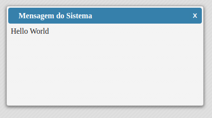
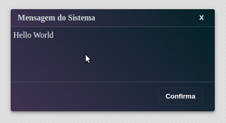
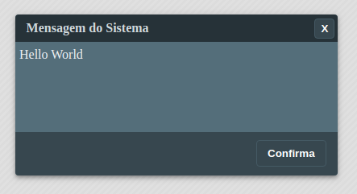
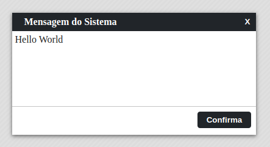
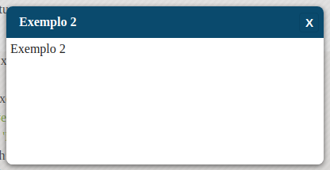

# xModal v3

O xModal é uma janela de diálogo personalizada inspirada inicialmente no showModal do Delphi.
Ele usa nativamente javascript em sua construção.

[Instalação](#instalação)<br>
[Importando](#importando)<br>
[Modo de Uso](#modo-de-uso)<br>
[Com Vue](#com-vue)<br>
[Temas](#temas)<br>
[Parâmetro Create](#parâmetro-create)<br>
[Métodos](#métodos)<br>
[Desenvolvedores](#desenvolvedores)<br>

## Instalação

```bash
npm install xmodalv2
```

A partir da v3 o pacote é ESM (`import`). Quem usava a v2 com `require('xmodalv2')` deve continuar na `^2.0.1`.

## Importando

<h3>Com bundler (Vite, webpack...)</h3>

```javascript
import xModal, { iModal, iModalCreate } from "xmodalv2";
```

E o CSS, uma vez no app (no `<style>` de um componente ou num `.css`):

```css
@import "xmodalv2/index.css";
```

<h3>Direto no html</h3>

```html
<link rel="stylesheet" href="node_modules/xmodalv2/xModal/index.css" />
<script src="node_modules/xmodalv2/xModal/xModal.js"></script>
<!-- expõe o global xModal -->
```

## Desenvolvimento

```bash
npm install
npm test            # testes (vitest + jsdom)
npm run typecheck   # tsc
npm run dev         # build em modo watch
npm run build       # sobe a versão (patch) e gera xModal/
```

O código fica em `index.ts` e `index.css`; `scripts/build.js` gera em `xModal/` o ESM (`xModal.mjs`), o
IIFE para `<script>` (`xModal.js`), os tipos (`index.d.ts`), o CSS e as imagens que ele usa.

## Modo de Uso

É necessário uma div no seu html com um id

```html
<!DOCTYPE html>
<html lang="pt-BR">
  <head>
    <title>xModal v1.0</title>
  </head>
  <body>
    <div id="minhaDiv">Hello World!</div>
    <script src="index.js" type="module"></script>
  </body>
</html>
```

No javascript iremos instanciar o objeto da seguinte forma:

<h3>Create</h3>

```javascript
const minhaDiv = new xModal.create({
  el: '#minhaDiv',
});

//// Abre o modal
minhaDiv.open();
```

## Com Vue

O elemento do modal costuma ser a raiz de um componente, escondida até o xModal assumir:

```vue
<script setup lang="ts">
import { onMounted } from "vue";
import xModal, { iModalCreate } from "xmodalv2";

let modal: iModalCreate;
onMounted(() => {
  modal = new xModal.create({ el: "#minhaDiv", title: "Meu modal" });
});
</script>

<template>
  <div id="minhaDiv" style="display: none">Hello World!</div>
</template>
```

O xModal move esse elemento para dentro de uma janela criada por ele e passa o `id` para a janela.
A partir da v3.0.2 ele acompanha o que o Vue faz com o elemento:

- **Edição do template (HMR):** o modal aberto continua aberto e mostra o conteúdo novo.
- **Edição do script ou de um `.ts` importado (HMR):** o Vue monta outra raiz com o mesmo `id`; o xModal
  refaz a janela em volta dela com as mesmas opções e, se estava aberta, reabre com os mesmos dados.
  A instância que o código guardou continua valendo.
- **`v-if` ou troca de rota:** quando a raiz sai da página, a janela, o fundo e o registro de "aberto" saem
  junto. Se a raiz voltar, o próximo `open()` da instância guardada usa a raiz nova.
- **`create` repetido no mesmo elemento:** substitui o modal anterior.

Pontos de atenção:

- A raiz nova é reconhecida pelo `id`; um modal criado por classe num elemento sem `id` não é religado.
- Quando a janela é refeita, `onCreate` roda de novo, e `onOpen` também se ela reabrir.
- `v-show` na raiz do modal não esconde o conteúdo: o xModal desfaz o `display: none` dela. Para esconder,
  use `close()`.
- Fora do HMR, um modal que ficou aberto numa tela que saiu não reabre sozinho quando a tela volta.
- Editar o template do componente pai inserindo um elemento logo antes do componente do modal ainda pede
  recarregar a página.

## Temas

<table>
    <tr>
        <th>xModal-blue</th>
        <th>xModal-opacity</th>
        <th>xModal-dark</th>
        <th>xModal-dark-square</th>
        <th>xModal-bublue</th>
    </tr>
    <tr>
        <td></td>
        <td></td>
        <td></td>
        <td></td>
        <td></td>
    </tr>
</table>

Também disponíveis: `xModal-v23`, `xModal-xAtila`, `xModal-xAtila-dark` e `xModal-Vyzo`.
O `xModal-Vyzo` usa as variáveis `--matdash-*`, `--bg-card` e `--v-theme-primary` quando a página
as define; sem elas, usa valores padrão (claro e, com `html.dark`, escuro).

Para todos os modais: `xModal.setTheme("xModal-Vyzo")` antes de criar, ou `xModal.changeTheme(...)`
para trocar os que já existem.

## Parâmetro Create

Create é responsável por instanciar o xModal. Recebe um objeto como parâmetro que pode ter as seguintes propriedades passadas:

<table>
    <tr>
        <th align="center">Propriedade</th>
        <th align="center">Descrição</th>
        <th align="center">Tipo</th>
        <th align="center">Default</th>
    </tr>
    <tr>
        <td>el</td>
        <td>Id do elemento (div) onde será instanciado o xModal. <strong>(Obrigatório)</strong></td>
        <td align="center">String</td>
        <td align="center"></td>
    </tr>
    <tr>
        <td>title</td>
        <td>Título da janela.</td>
        <td align="center">String</td>
        <td align="center">Mensagem do Sistema</td>
    </tr>
    <tr>
        <td>width</td>
        <td>Largura da janela.</td>
        <td align="center">Numeric</td>
        <td align="center">75%</td>
    </tr>
    <tr>
        <td>height</td>
        <td>Altura da janela.</td>
        <td align="center">Numeric</td>
        <td align="center">75%</td>
    </tr>
    <tr>
        <td>resize</td>
        <td>Propriedade que informa se poderá redimensionar a janela.</td>
        <td align="center">Boolean</td>
        <td align="center">False</td>
    </tr>
    <tr>
        <td>theme</td>
        <td>Tema que será utilizado na janela, temas disponíveis:<br>
        xModal-blue, xModal-opacity, xModal-dark </td>
        <td align="center">String</td>
        <td align="center">xModal-blue</td>
    </tr>
    <tr>
        <td>left</td>
        <td>Define a posição (left) onde a janela será aberta.</td>
        <td align="center">Numeric</td>
        <td align="center"></td>
    </tr>
    <tr>
        <td>top</td>
        <td>Define a posição (top) onde a janela será aberta.</td>
        <td align="center">Numeric</td>
        <td align="center"></td>
    </tr>
    <tr>
        <td>fullScreen</td>
        <td>Caso queira que a janela abre em tela cheia, informe true.</td>
        <td align="center">Boolean</td>
        <td align="center">False</td>
    </tr>
    <tr>
        <td>closeBtn</td>
        <td>Mostra o botão fechar no canto superior direito da janela</td>
        <td align="center">Boolean</td>
        <td align="center">True</td>
    </tr>
    <tr>
        <td>esc</td>
        <td>Determina se o botão esc pode fechar o modal.</td>
        <td align="center">Boolean</td>
        <td align="center">True</td>
    </tr>
    <tr>
        <td>modal</td>
        <td>Limita o acesso apenas a janela aberta.</td>
        <td align="center">Boolean</td>
        <td align="center">True</td>
    </tr>
    <tr>
        <td>titleDisplay</td>
        <td>Possibilita a visualização ou não da barra de título da janela.</td>
        <td align="center">Boolean</td>
        <td align="center">True</td>
    </tr>
    <tr>
        <td>onCreate</td>
        <td>Função que será executada ao instanciar o objeto. Roda de novo se a janela for refeita (veja <a href="#com-vue">Com Vue</a>).</td>
        <td align="center">Function</td>
        <td align="center"></td>
    </tr>
    <tr>
        <td>onOpen</td>
        <td>Função que será executada sempre que abrir a janela. Recebe o valor passado em <code>open(dados)</code>.</td>
        <td align="center">Function</td>
        <td align="center"></td>
    </tr>
    <tr>
        <td>onClose</td>
        <td>Função que será executa sempre que fechar a janela.</td>
        <td align="center">Function</td>
        <td align="center"></td>
    </tr>
    <tr>
        <td>setTheme</td>
        <td>Função que seta o thema para novas intancias.
            xModal.setTheme('xModal-dark-square')
        </td>
        <td align="center">string</td>
        <td align="center">xModal-bublue</td>
    </tr>
    <tr>
        <td>changeTheme</td>
        <td>Função que altera todas as intancias corrente e seta o thema para a futuras intancias.
            xModal.changeTheme('xModal-dark-square')
        </td>
        <td align="center">string</td>
        <td align="center"></td>
    </tr>
    <tr>
        <td>onKeyDown</td>
        <td>Permite a janela escutar pressionamento de teclas e executar uma função para as teclas determinadas.<pre>
onKeyDown:{
    13: (e)=>{console.log('enter pressionado')},    
    'ctrl+13': (e)=>{console.log('ctrl+enter pressionado')}
    'ctrl+shift+alt+13': (e)=>{
        console.log('ctrl+shift+alt+13 pressionado')}
    }</pre></td>
        <td align="center">Object</td>
        <td align="center"></td>
    </tr>
    <tr>
        <td>buttons</td>
        <td>Botões que irão aparecer na janela.<pre>
buttons:{
    btn1:  // identificador do botão
    {
        html: 'Confirma', //texto do botão
        class: 'left',    // class do botão (opcional)
        click: (e)=>{
            // função que será executada ao 
            clicar no botão
        }   
    },
    btn2:{ // pode ser adicionado n botões }
}
        </pre></td>
        <td align="center">Object</td>
        <td align="center"></td>
    </tr>
    <tr>
        <td>execAfter</td>
        <td>Invoca o clique do botão após determinado tempo.
        <pre>execAfter{
            time: 10,           // tempo em segundos
            btn: 'confirma'     // nome do btn
        }</pre>
        </td>
        <td align="center">Object</td>
        <td align="center"></td>
    </tr>
</table>

## Métodos

Esses métodos serão utilizados na variável instanciada. Ex.:<br>

```javascript
minhaDiv.close();
```

<table>
    <tr>
        <th>Método</th>
        <th align="center">Parâmetro</th>
        <th>Descrição</th>
    <tr>
    <tr>
        <td>btnFocus</td>
        <td align="center">nameBtn: String</td>
        <td>Coloca o foco no botão passado por parâmetro.</td>
    </tr>
    <tr>
        <td>btnDisable</td>
        <td align="center">nameBtn: String</td>
        <td>Desabilita o botão passado por parâmetro.</td>
    </tr>
    <tr>
        <td>btnEnable</td>
        <td align="center">nameBtn: String</td>
        <td>Habilita o botão passado por parâmetro.</td>
    </tr>
    <tr>
        <td>btnClick</td>
        <td align="center">nameBtn: String</td>
        <td>Clica no botão passado por parâmetro.</td>
    </tr>
    <tr>
        <td>setTitle</td>
        <td align="center">title: String</td>
        <td>Altera o título da janela.</td>
    </tr>
    <tr>
        <td>open</td>
        <td align="center">dados: any (opcional)</td>
        <td>Abre a janela de diálogo. O valor é repassado ao <code>onOpen</code>.</td>
    </tr>
    <tr>
        <td>close</td>
        <td align="center">nenhum</td>
        <td>Fecha a janela de diálogo.</td>
    </tr>
    <tr>
        <td>destroy</td>
        <td align="center">nenhum</td>
        <td>Destrói a instância criada.</td>
    </tr>
</table>

## Desenvolvedores

[Francisco Alves](https://github.com/dffrancisco)<br>
[Guilherme Trindade](https://github.com/guigagb)
